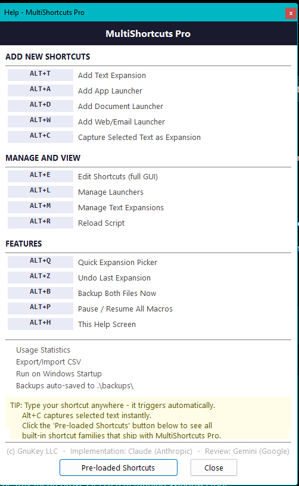
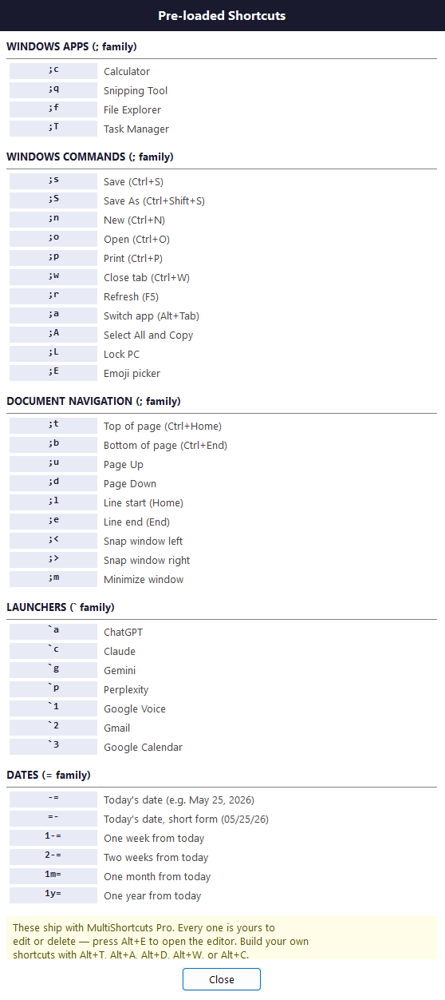

# MultiShortcuts Pro

**Ctrl and Alt, now on your home row. And Ctrl on your mouse, for easy editing.** Hold `;` for Ctrl, hold Caps Lock for Alt, hold the mouse wheel for Ctrl. Go no further than this, and your computer is already easier to use. It's just the beginning.

**MultiShortcuts Pro** is a free AutoHotkey v2 productivity tool for Windows, published by **GnuKey LLC**.

It lets you use short typed codes and hotkeys to expand text, launch apps and websites, open documents, insert dates, capture selected text, manage shortcuts, and trigger common productivity actions.

Website: https://multishortcutspro.speedkee.com

### Headline feature: Ctrl and Alt, now on your home row

No shortcuts to make: every Ctrl shortcut you already use (copy, paste, undo, save) works the same; you just hold the semicolon key instead of reaching for **Ctrl** (hold `;` + C = copy). Hold **Caps Lock** for **Alt** (hold + Tab = switch windows), and tap it for a backtick, so Caps Lock then C opens your Claude launcher. Shift + Caps Lock is still the normal Caps Lock. A quick tap of `;` still types it, so every shortcut keeps working. Holding `;` + C even copies *part* of a text you are editing, which typed shortcuts cannot do.

It is on from the start, for new installs and upgrades alike, with no key remapping or extra programs needed. Each part can be turned off in the tray menu. The middle mouse button works like the semicolon by default (click then V pastes; hold it for Ctrl, handy for editing with the mouse). It can also work like Caps Lock, or be the normal middle click again; choose in the tray menu. Shift + middle click always gives the normal middle click.

---

## Screenshots

---

## Requirements

- Windows 10 or Windows 11
- AutoHotkey v2

Download AutoHotkey v2 here:

https://www.autohotkey.com/

---

## Download

Download the latest version from the **Releases** page.

The main program file is:

`MultiShortcutsPro.ahk`

---

## What MultiShortcuts Pro can do

MultiShortcuts Pro includes tools for:

- Text expansions
- App and website launchers
- Document launchers
- Date shortcuts
- Capturing selected text as a shortcut
- Editing and managing shortcuts
- Expansion history and undo
- Usage statistics
- Backups
- CSV import and export

---

## Quick start

1. Install AutoHotkey v2.
2. Download `MultiShortcutsPro.ahk` from the latest release.
3. Double-click `MultiShortcutsPro.ahk`.
4. Right-click the MultiShortcuts Pro tray icon to open the menu.

MultiShortcuts Pro starts in **Starter mode**: the built-in `;`, `` ` `` and `=` shortcuts work right away. When you want your own shortcuts, the editor and the other tools, choose **Unlock Full Features** from the tray menu. It's free.

Hold keys and the Caps Lock launcher key are on from the start (see above). To change them, right-click the tray icon.

---

## Privacy

MultiShortcuts Pro runs locally on your computer.

Your shortcuts are stored in local plain-text files. The script does not require an account, subscription, telemetry service, or cloud account.

You can open the `.ahk` file in a text editor and inspect the code.

---

## Support

For bug reports, you can open a GitHub Issue or email:

support.team@gnukey.com

---

## License

MIT License.